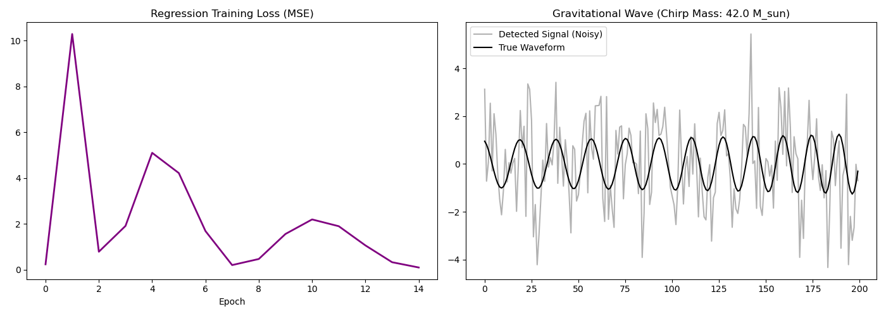

# Gravitational Wave Parameter Estimation via 1D ResNet

## Overview
This computational astrophysics project simulates binary black hole inspiral waveforms and utilizes a deep learning regression pipeline to extract continuous physical parameters (chirp mass) from heavily noise-corrupted strain data, mimicking advanced LIGO analysis.

## Architecture
The pipeline bridges numerical relativity approximations with modern AI architectures:
1. **Physics Engine (Fortran):** A high-performance numerical generator that models the post-Newtonian frequency evolution of binary black hole mergers. It calculates the phase and amplitude of gravitational wave strain ($h(t)$) over time for varying initial masses.
2. **AI Regression Pipeline (PyTorch):** A 1D Residual Neural Network (ResNet). Unlike basic classifiers, this network is built for continuous parameter extraction. It analyzes the time-series strain data—injected with Gaussian noise to simulate interferometer static—and uses skip connections to prevent gradient vanishing while mapping the noisy signal to a precise scalar mass value.

## Tech Stack
* **Physics Simulation:** Fortran (gfortran)
* **Deep Learning & Regression:** Python, PyTorch, NumPy
* **Data Visualization:** Matplotlib

## Results
The ResNet successfully converges using Mean Squared Error (MSE) loss, demonstrating the ability to see through severe detector noise and predict the accurate physical chirp mass of the binary system. This bypasses the traditional, computationally expensive Markov Chain Monte Carlo (MCMC) parameter estimation methods.

